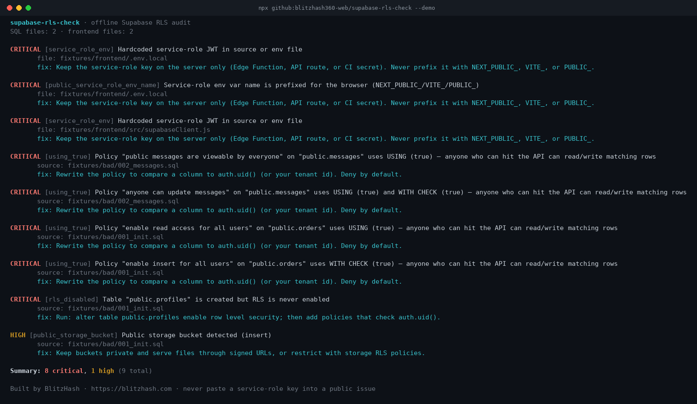

# supabase-rls-check

**Find open Supabase tables, `USING (true)` policies and leaked service-role keys in your migrations before strangers do. Offline, no account, one command.**

[](https://github.com/blitzhash360-web/supabase-rls-check/actions/workflows/ci.yml)
[](LICENSE)
[](https://nodejs.org)
[](#github-action)
[](https://blitzhash.com)


<sub>Real output of `npx github:blitzhash360-web/supabase-rls-check --demo`, which scans the example schema in [fixtures/](fixtures).</sub>

## Quick start (3 steps)

You need [Node.js 18 or newer](https://nodejs.org). Nothing else.

```bash
# 1. See it work on the bundled example schema (nothing of yours is read)
npx -y github:blitzhash360-web/supabase-rls-check --demo

# 2. Run it on your own migrations (or a SQL dump)
npx -y github:blitzhash360-web/supabase-rls-check --sql ./supabase/migrations

# 3. Optional: also scan your frontend for service-role leaks, then fix CRITICAL / HIGH and re-run
npx -y github:blitzhash360-web/supabase-rls-check --sql ./supabase/migrations --frontend ./src
```

No account. No network call to your project. Never paste a **service-role** key into this tool or a public issue: it only needs your SQL files and (optionally) your frontend source. It exits with code `1` when it finds something at `--fail-on` severity (default `high`), so it drops straight into CI.

## What it checks

| Check | Severity | Why it matters |
|---|---|---|
| Table created without `ENABLE ROW LEVEL SECURITY` | critical | With the Data API on, the anon key can read/write the whole table |
| `USING (true)` / `WITH CHECK (true)` policies | critical | RLS is "on" but every row is still public to whoever can call the API |
| `storage.buckets` marked `public = true` | high | Anyone with the URL can download the files |
| `service_role` JWT or `NEXT_PUBLIC_*SERVICE_ROLE*` in frontend / `.env*` | critical | The service role bypasses RLS entirely — it must never ship to the browser |

## Why this matters (plain English)

If you built with Lovable, Bolt, Cursor, v0, or Replit + Supabase, the preview can look perfect while your `orders` or `messages` table is wide open. AI scaffolds often suggest **"Enable read access for all users"** with `using (true)`. That turns Row Level Security into a decorative lock: the badge says secure, the door is open.

This checker reads your SQL migrations (or a dump) offline and lists the exact policies and tables to fix. Pair it with an **Empty-Account Test**: open the app in a private window with a brand-new user and confirm you cannot see anyone else's rows.

## GitHub Action

Copy the workflow from [`.github/workflows/rls-check.yml`](.github/workflows/rls-check.yml), or use the composite action:

```yaml
- uses: blitzhash360-web/supabase-rls-check@main
  with:
    sql: supabase/migrations
    frontend: src
    fail-on: high
```

## Options

```text
--sql, -s <path>       SQL dump or migrations folder (repeatable)
--frontend, -f <path>  Frontend / env tree to scan (repeatable)
--json                 JSON report
--fail-on <level>      critical|high|medium|low (default: high)
--demo                 Scan the bundled example schema
--no-color             Disable ANSI colors
```

## Develop / test

```bash
git clone https://github.com/blitzhash360-web/supabase-rls-check
cd supabase-rls-check
npm test
node bin/supabase-rls-check.js --demo
```

Fixtures under `fixtures/bad` and `fixtures/good` are intentional demo schemas — not real client data.

## Credits

- Inspired by the Supabase docs on [Row Level Security](https://supabase.com/docs/guides/database/postgres/row-level-security) and the community pattern of auditing `USING (true)` policies.
- Related open-source work worth knowing (we are **not** a rebrand of these): [VibeRaven](https://github.com/ohad6k/VibeRaven), [supashield](https://github.com/Rodrigotari1/supashield), [supabase-rls-checker](https://github.com/hand-dot/supabase-rls-checker) (Chrome extension). This repo is a small offline CLI + Action focused on migrations/dumps and frontend service-role leaks.

## License

MIT © BlitzHash

---

Built by BlitzHash: need a senior team to check or scale your AI-built app? Free assessment at https://blitzhash.com

Want a second pair of eyes? Book a free 15-minute launch review: https://calendly.com/blitzhash360/free-15-min-launch-review
